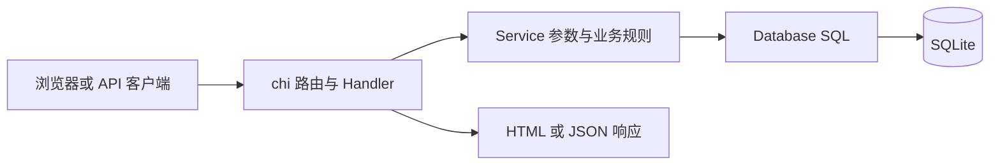

# 请求如何走完一圈

## 创建

POST /api/shorten → 验证 JSON/URL/短码/过期时间 → Service 生成或选择短码 → SQLite INSERT → 返回 ID 与短链接。

数据库的 UNIQUE(short_code) 是并发冲突的最终约束，不能只依赖“先查有没有”。驱动的唯一约束错误被映射成领域错误，再映射成 HTTP 409。

## 列表

Handler 将 q/status/page/page_size 转为 ListOptions；Service 去空白并检查搜索长度；Database 组合固定 SQL 条件并通过参数传值。

COUNT 与分页 SELECT 使用同一读事务，避免这两个查询之间的新增/删除使 total 与本页数据不一致。ORDER BY created_at DESC, id DESC 消除同一创建时间的排序歧义。LIMIT/OFFSET 在数据库中执行，不先加载全表再切片。

索引 (created_at DESC, id DESC) 服务于默认排序。instr(lower(...)) 子串搜索并没有因此变成索引检索：它仍可能扫描数据。不同页面间发生新增时，OFFSET 分页仍可能移动；此处没有实现跨请求快照或游标分页。

## 过期

expires_at 为可空 Unix 秒，Go 模型对外使用 RFC3339 时间。NULL 表示长期有效。now >= expires_at 时失效。

管理查询仍能找到过期记录；只有公开跳转拒绝它，返回 410，且不记录点击。没有后台任务删除过期记录，便于查看与人工整理。Web 选择有效小时数，API 接收明确时区的时间。

## 表结构迁移

启动先 CREATE TABLE IF NOT EXISTS，然后读取 PRAGMA table_info(urls)。旧库缺少 expires_at 时执行 ALTER TABLE ADD COLUMN。旧记录的该字段自然为 NULL，不丢失旧数据。迁移启动按单实例设计，不支持多个进程同时对同一个旧库做 schema 变更。

## 资源与错误

单实例使用一个 SQLite 连接并设置 busy_timeout。列表操作传播请求 Context；Rows 读取后检查 Err 并关闭。点击计数使用 SQL 原子加一并在返回跳转前同步执行，更新失败记日志但不阻断有效链接跳转。

创建、单条读取及点击等继承接口尚未全面传递 Context；不声称所有数据库操作都能随客户端断开立即取消。

## 认证与跨站写保护

Basic Auth 覆盖管理页面、管理 API 和二维码。公开跳转与 /healthz 不要求登录。删除从 GET 改为 POST；Go 1.25 的 CrossOriginProtection 拒绝跨站浏览器非安全方法。API 创建只接受 JSON，并限制请求体大小。

这不是完整的企业权限系统。对外托管还需 HTTPS、运维备份和视业务需要增加的限流与防滥用控制。
